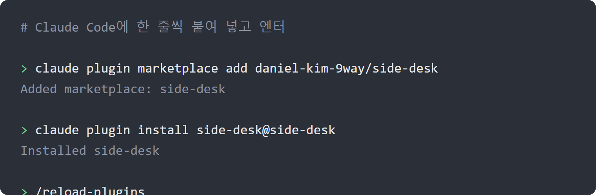
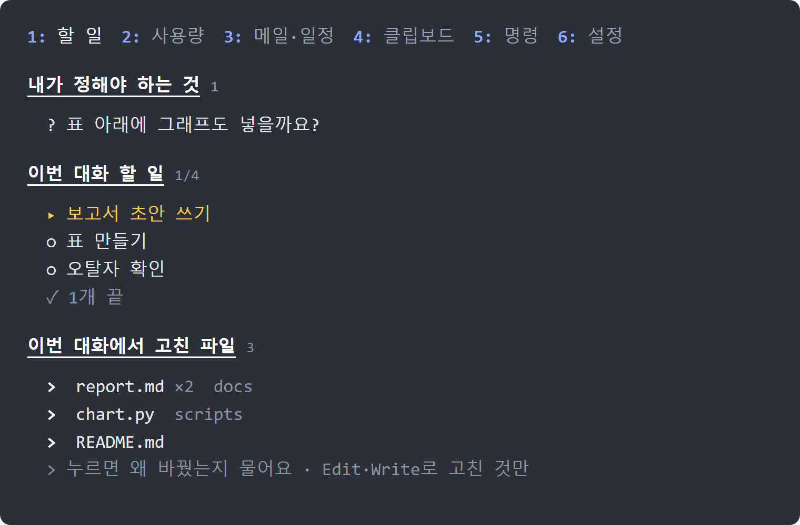
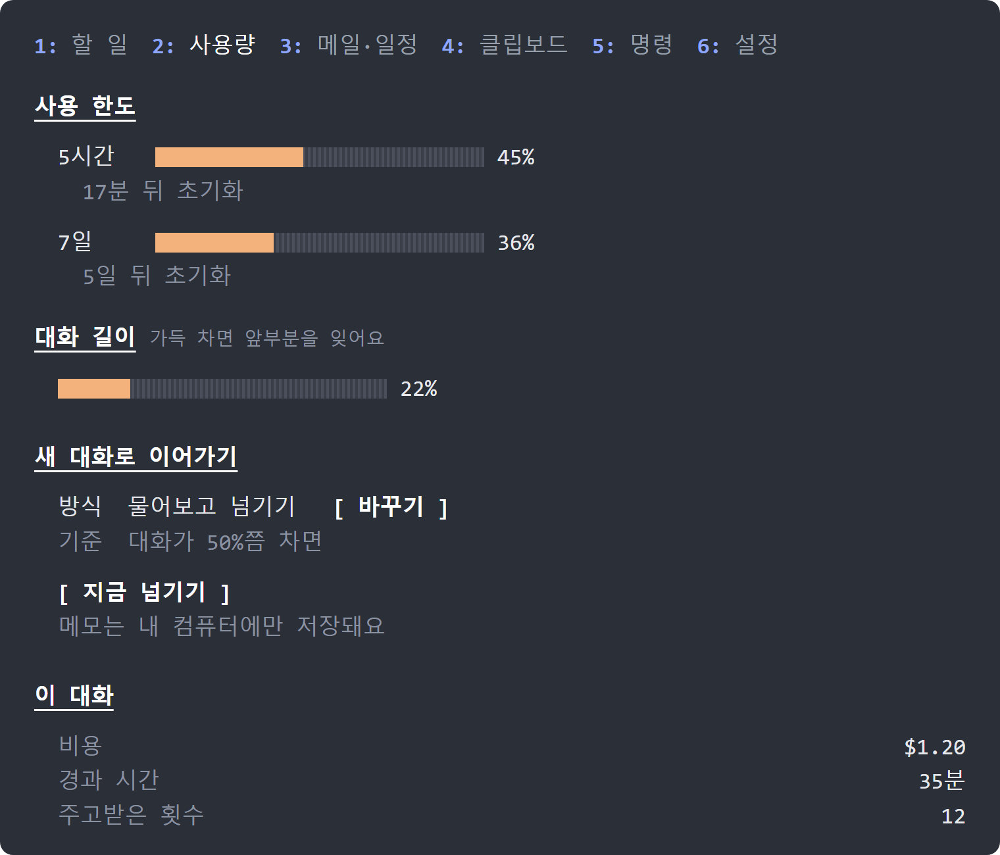
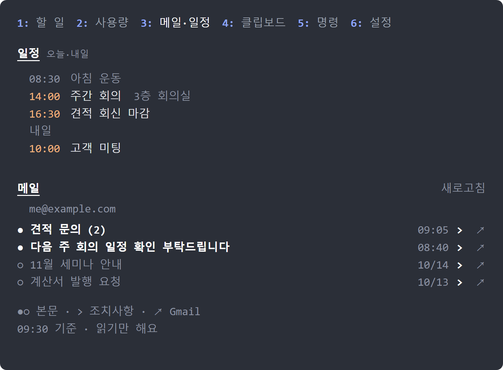
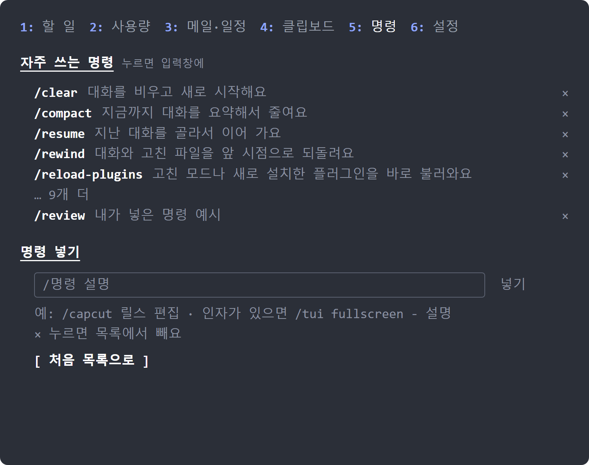
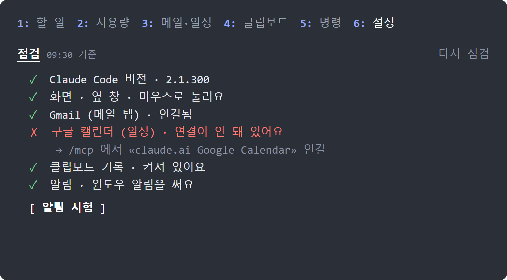

# side-desk — Claude Code 옆에 «책상» 하나

Claude Code로 일하다 보면 이런 일이 생겨요.

- 일을 여러 단계로 맡겼는데, 대화가 길어지니 **지금 어디까지 했는지** 놓쳐요.
- Claude가 물어본 질문이나 «이거 실행해도 될까요?»를 못 보고 자리를 비워요.
- Claude가 **어떤 파일을 고쳤는지** 모른 채 넘어가요.
- **사용 한도**가 얼마나 남았는지, 대화가 얼마나 길어졌는지 몰라요.
- 대화가 너무 길어져서 Claude가 앞 내용을 잊기 시작해요.
- 새 메일이나 오늘 일정을 보려고 브라우저를 오가요.
- 방금 복사한 글이나 이미지를 입력창에 넣고 싶은데, 복사해 둔 게 여러 개예요.
- 메일을 «써 줘»라고 했는데 Claude가 **그대로 보내 버릴까** 불안해요.

side-desk는 Claude Code 화면 옆에 작은 창을 열어서 이걸 한 곳에 모아 줘요.

> **윈도우에서 만들고 시험했어요.** WSL(윈도우의 리눅스)에서도 돼요. 맥·리눅스에서는 클립보드 탭만 안 되고, 알림은 윈도우 알림 대신 터미널 알림으로 가요(터미널이 알림을 지원해야 떠요).
> 이 모드는 **서버를 두지 않고, 내 글을 밖으로 보내지 않아요.** 메일 탭만 Claude Code에 연결된 Gmail·구글 캘린더 커넥터로 받은편지함과 오늘 일정을 읽어요. 아래 «무엇을 하나요»를 꼭 읽어 보세요.

## 설치 (2줄)

**먼저 버전을 확인하세요.** 터미널에 `claude --version`을 쳐서 **2.1.287 이상**인지 봐요. 그보다 낮으면 `claude update`를 먼저 치세요. 낮은 버전에 설치하면 `Failed to load hooks ... expected record` 오류가 나요.

Claude Code에 아래 두 줄을 한 줄씩 붙여 넣고 엔터를 누르세요.

```
claude plugin marketplace add daniel-kim-9way/side-desk
claude plugin install side-desk@side-desk
```



설치가 끝나면 Claude Code를 다시 열거나 `/reload-plugins`를 치세요. 그다음 입력창에 `/desk`를 치면 옆에 책상이 열려요.

처음이면 **6 설정 탭**부터 열어 보세요. 버전·화면·Gmail·캘린더·클립보드 기록·알림을 점검해서, 안 되는 것마다 고치는 법을 한 줄로 알려 줘요. 입력창에 `/desk check`를 쳐도 같은 점검을 글로 볼 수 있어요.

## 이렇게 보여요

> 아래 그림은 설명용 예시 화면이에요. 숫자와 할 일은 예시고, 글자 배치는 실제 화면과 같아요.

**할 일** — Claude가 쌓은 할 일, 내 답을 기다리는 질문, 이번 대화에서 고친 파일



**사용량** — 사용 한도와 대화 길이, 그리고 새 대화로 이어가기



**메일·일정** — 오늘·내일 일정, 그 아래 받은편지함 제목. 누르면 본문을 읽어요 (일정과 메일 제목은 예시예요)



**명령** — 자주 쓰는 명령. 누르면 입력창에 들어가요. `×`로 빼고, 아래 칸에 써서 넣어요



**설정** — 처음 설정 점검 (설정 탭 가운데 부분이에요)



## 탭 여섯 개

| 탭 | 하는 일 |
|---|---|
| **1 할 일** | Claude가 쌓아 둔 **이번 대화 할 일**, 그리고 **내가 정해야 하는 것**을 고정해 둬요. 대화가 길어져도 안 밀려나요. 아래에는 **이번 대화에서 Claude가 고친 파일**이 최근 것부터 보여요. `>`를 누르면 «이 파일 왜 바꿨는지 설명해 줘»를 입력창에 채워요. |
| **2 사용량** | 5시간·7일 **사용 한도**, 초기화까지 남은 시간, **대화 길이**, 이 대화의 비용. 한도가 80%를 넘으면 알려 줘요. 대화가 길어지면 «이어서 할 일»을 메모로 쓰고 **새 대화로 넘길지 물어봐요.** 새 대화는 그 메모를 읽고 바로 이어서 해요. |
| **3 메일·일정** | 맨 위에 **구글 캘린더의 오늘·내일 일정**을 보여 줘요. 그 아래는 Claude Code에 연결된 **Gmail** 받은편지함의 최근 20개를 **제목만** 보여 줘요. 줄을 누르면 그때 본문을 불러와요. `>`를 누르면 «이 메일을 읽고 내가 할 일을 찾아 줘»라는 글을 입력창에 채워요(보내기는 엔터로 해요). `↗`는 브라우저의 Gmail로 열어요. **둘 다 읽기만 해요.** |
| **4 클립보드** | 최근에 복사한 글·이미지 목록(윈도우 Win+V 기록). 줄을 누르면 입력창에 들어가요. |
| **5 명령** | `/clear`·`/compact`·`/resume`·`/mcp` 같은 **자주 쓰는 명령**을 쉬운 말로 풀어 뒀어요. 누르면 입력창에 넣기만 하고, 실행은 엔터로 해요. 줄 끝 `×`로 빼고, 아래 칸에 `/명령 설명`을 쓰고 엔터를 누르면 넣어요(예: `/capcut 릴스 편집`, 인자가 있으면 `/tui fullscreen - 설명`). «처음 목록으로»를 누르면 되돌려요. |
| **6 설정** | 보내기 전 확인 · 질문·승인 알림 · 작업 끝 알림 · 프롬프트 가이드를 켜고 꺼요. **처음 설정 점검**(✓/✗와 고치는 법)과 «알림 시험»이 있어요. |

옆 창이 좁으면 탭 이름이 «할일 · 한도 · 메일 · 클립 · 명령 · 설정»으로 줄고(넓으면 «메일·일정»), 그래도 넘치면 두 줄로 나뉘어요. 긴 제목은 `…`로 자르고, 여러 줄로 넘어가는 설명은 같은 들여쓰기로 이어져요.

입력창에서 바로 쓰는 명령도 있어요.

| 명령 | 하는 일 |
|---|---|
| `/desk` | 책상을 열어요. `/desk text`는 글로 요약해서 보여 주고, `/desk check`는 처음 설정 점검을 글로 보여 줘요. |
| `/clip` | 지금 클립보드의 글을 입력창에 붙여요. 이미지는 파일로 저장하고 그 경로를 붙여요. |
| `/handoff` | 대화를 지금 새 대화로 넘겨요. |
| `/coach` | 프롬프트 가이드를 켜고 꺼요. |

## 무엇을 하나요 (꼭 읽어 주세요)

이 모드는 **내 컴퓨터에서 내 권한으로** 돌아요. 그래서 무엇을 하는지 정확히 적어 둬요.

- **PowerShell을 실행해요.** 클립보드를 읽고 알림을 띄울 때, 그리고 설정 탭의 점검에서 클립보드 기록이 켜져 있는지 볼 때만이에요. 클립보드 탭을 볼 때 보이지 않는 PowerShell 하나가 클립보드가 바뀌는지만 지켜봐요. 탭을 1분 넘게 안 보면 끝나요.
- **파일을 써요.** 대화를 이어갈 때 쓰는 메모와, 클립보드 이미지를 저장한 파일이에요. 모두 `내 폴더/.claude/state/side-desk/` 아래에 있고, 이미지는 하루 뒤 지워져요.
- **고친 파일 목록을 남겨요.** Claude가 `Edit`·`Write`·`NotebookEdit`로 파일을 고칠 때마다 그 경로만 적어 둬요(파일 내용은 안 적어요). Claude Code가 모드에 주는 저장 공간에 대화마다 따로 두고, 최근 30개 대화만 남겨요. 셸 명령으로 바꾼 파일은 안 잡혀요.
- **서버가 없고, 내 글을 밖으로 보내지 않아요.** 이 모드가 외부 주소로 직접 요청하는 일은 없어요.
- **메일 탭은 Gmail·구글 캘린더 커넥터로 읽기만 해요.** Claude Code에 이미 연결해 둔 «claude.ai Gmail»과 «claude.ai Google Calendar» 커넥터를 거쳐요. 메일 탭을 열 때, «새로고침»을 누를 때, 메일 탭을 보고 있는 동안 5분마다 받은편지함 제목과 오늘·내일 일정을 읽고, 줄을 누를 때만 메일 본문을 읽어요. 창이 닫혀 있거나 다른 탭을 보고 있으면 읽지 않아요. 읽음 표시·라벨·답장·삭제·일정 변경은 하지 않고, 읽은 메일과 일정을 따로 저장하지도 않아요.
- **설정 탭의 점검은 커넥터를 한 번씩 불러 봐요.** 설정 탭을 처음 열 때와 «다시 점검»을 누를 때 Gmail과 캘린더에 가장 작은 요청을 하나씩 보내서 연결됐는지만 봐요.
- **알림은 스위치가 둘이에요.** «질문·승인 알림»(기본 켜짐)은 Claude가 질문할 때, «이 도구를 써도 될까요?» 승인 창이나 보내기 전 확인이 떴을 때 알려요. «작업 끝 알림»(기본 꺼짐)은 오래 걸린 일이 끝났을 때 알려요. 윈도우는 PowerShell로 윈도우 알림을, 맥·리눅스는 Claude Code가 터미널로 보내는 알림을 써요.
- **«보내기 전 확인»은 이래요.** Claude가 메일 보내기, 광고 변경, 일정 초대, 드라이브 공유 같은 일을 하려 하면 받는 사람·제목·본문을 보여 주고 «보낼까요?»를 물어요. 읽기·검색·초안 저장은 묻지 않아요.
- **«프롬프트 가이드»는 기본이 꺼져 있어요.** 켜면 내가 보내는 요청마다 작은 모델을 한 번 더 써서 사용 한도를 조금 더 써요.

### 클립보드를 쓸 때 조심할 점

윈도우의 클립보드 기록(Win+V)에는 **비밀번호처럼 복사해 둔 글도 남아요.** 클립보드 탭은 그걸 그대로 보여 주고, 줄을 누르면 입력창에 넣어요. 보내기 전에 눈으로 확인하세요. 이 모드는 클립보드 내용을 따로 저장하지 않아요.

## 자주 묻는 것

**설치했더니 `Failed to load hooks ... "expected": "record" ... "path": ["hooks"]` 오류가 나요.** Claude Code가 2.1.287보다 낮은 버전이라 이 모드를 못 읽는 거예요. 터미널에서 `claude update`를 치고 Claude Code를 다시 여세요. `claude --version`이 2.1.287 이상이면 오류가 사라져요. 다시 설치할 필요는 없어요.

**옆 창이 안 열려요.** 터미널 폭이 144칸보다 좁으면 자동으로는 열리지 않아요. `/desk`로 열면 돼요. `/reload-plugins`를 치고 다시 해 보세요.

**뭐가 안 되는지 모르겠어요.** 6 설정 탭의 «점검»을 보세요. ✗가 붙은 줄 아래에 고치는 법이 있어요. 입력창에 `/desk check`를 쳐도 돼요.

**일정이 안 보여요.** claude.ai 설정 > 커넥터에서 구글 캘린더를 먼저 추가하고, `/mcp`에서 «claude.ai Google Calendar»에 로그인하세요. «캘린더를 읽는 권한을 아직 안 받았어요»가 나오면 `/permissions`에서 `mcp__claude_ai_Google_Calendar__list_events`를 허용하세요. 기본 캘린더만 보여요.

**클립보드 탭이 «읽는 중…»에서 멈춰요.** 설정 > 시스템 > 클립보드에서 «클립보드 기록»을 켜세요. 꺼져 있으면 지금 클립보드 한 개만 보여요. 그래도 안 되면 탭 아래에 이유가 한 줄 나와요.

**새 대화로 넘기는 게 싫어요.** 2 사용량 탭의 «새 대화로 이어가기»에서 «바꾸기»를 눌러 «끔»을 고르세요.

**메일 탭에 «연결하기»만 보여요.** claude.ai 설정 > 커넥터에서 Gmail을 먼저 추가하세요. 그다음 «연결하기»를 누르면 `/mcp` 창이 열려요. «claude.ai Gmail»을 골라 로그인하고 «다시 시도»를 누르세요. «메일을 읽는 권한을 아직 안 받았어요»가 나오면 `/permissions`에서 `mcp__claude_ai_Gmail__search_threads`와 `mcp__claude_ai_Gmail__get_thread`를 허용하세요.

**너무 자주 알림이 와요.** 6 설정 탭에서 «작업 끝 알림»이나 «질문·승인 알림»을 끄세요. 작업 끝 알림은 처음부터 꺼져 있어요.

**전부 끄고 싶어요.** 환경 변수 `SIDE_DESK_OFF=1`을 두고 Claude Code를 여세요. 아니면 `/plugin`에서 side-desk를 끄세요.

## 호환 버전

Claude Code **2.1.287 이상**이 필요해요. 2.1.300에서 시험했어요. 모드 기능은 버전마다 바뀔 수 있어요.

## 만든 방식과 출처

할 일·사용량·프롬프트 가이드·이어가기의 구조는 아래 오픈소스 모드에서 참고했어요. 자세한 표기는 `NOTICE`에 있어요.

- [pinboard](https://github.com/sirkitree/pinboard) — Jerad Bitner (MIT)
- [claude-mods](https://github.com/mishgoldenberg/claude-mods)의 usage-meter·prompt-coach — Michael Goldenberg (MIT)
- [claude-auto-handoff](https://github.com/alexknowshtml/claude-auto-handoff) — Alex Hillman (MIT)

## 라이선스

MIT. `LICENSE`를 보세요.
