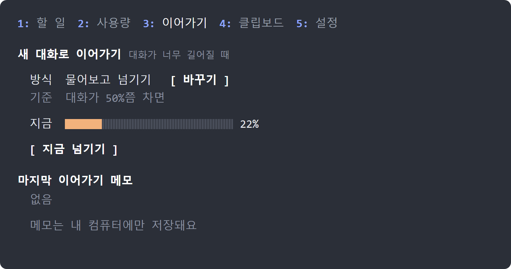

# side-desk — Claude Code 옆에 «책상» 하나

Claude Code로 일하다 보면 이런 일이 생겨요.

- 일을 여러 단계로 맡겼는데, 대화가 길어지니 **지금 어디까지 했는지** 놓쳐요.
- Claude가 물어본 질문을 못 보고 지나가요.
- **사용 한도**가 얼마나 남았는지, 대화가 얼마나 길어졌는지 몰라요.
- 대화가 너무 길어져서 Claude가 앞 내용을 잊기 시작해요.
- 방금 복사한 글이나 이미지를 입력창에 넣고 싶은데, 복사해 둔 게 여러 개예요.
- 메일을 «써 줘»라고 했는데 Claude가 **그대로 보내 버릴까** 불안해요.

side-desk는 Claude Code 화면 옆에 작은 창을 열어서 이걸 한 곳에 모아 줘요.

> **윈도우용이에요.** 클립보드와 알림은 윈도우에서만 돼요. WSL(윈도우의 리눅스)에서도 돼요. 맥에서는 할 일·사용량·이어가기·발송 확인만 돼요.
> 이 모드는 **인터넷으로 아무것도 보내지 않아요.** 아래 «무엇을 하나요»를 꼭 읽어 보세요.

## 설치 (2줄)

Claude Code에 아래 두 줄을 한 줄씩 붙여 넣고 엔터를 누르세요.

```
claude plugin marketplace add daniel-kim-9way/side-desk
claude plugin install side-desk@side-desk
```


설치가 끝나면 Claude Code를 다시 열거나 `/reload-plugins`를 치세요. 그다음 입력창에 `/desk`를 치면 옆에 책상이 열려요.

## 이렇게 보여요

> 아래 그림은 설명용 예시 화면이에요. 숫자와 할 일은 예시고, 글자 배치는 실제 화면과 같아요.

**할 일** — Claude가 쌓은 할 일과, 내 답을 기다리는 질문


**사용량** — 사용 한도와 대화 길이


**이어가기** — 대화가 너무 길어지면 새 대화로 넘겨요



## 탭 다섯 개

| 탭 | 하는 일 |
|---|---|
| **1 할 일** | Claude가 쌓아 둔 **이번 대화 할 일**, 그리고 **내가 정해야 하는 것**을 고정해 둬요. 대화가 길어져도 안 밀려나요. |
| **2 사용량** | 5시간·7일 **사용 한도**, 초기화까지 남은 시간, **대화 길이**, 이 대화의 비용. 한도가 80%를 넘으면 알려 줘요. |
| **3 이어가기** | 대화가 길어지면 «이어서 할 일»을 메모로 쓰고, **새 대화로 넘길지 물어봐요.** 새 대화는 그 메모를 읽고 바로 이어서 해요. |
| **4 클립보드** | 최근에 복사한 글·이미지 목록(윈도우 Win+V 기록). 줄을 누르면 입력창에 들어가요. |
| **5 설정** | 보내기 전 확인 · 알림 · 프롬프트 가이드를 켜고 꺼요. |

입력창에서 바로 쓰는 명령도 있어요.

| 명령 | 하는 일 |
|---|---|
| `/desk` | 책상을 열어요. `/desk text`는 글로 요약해서 보여 줘요. |
| `/clip` | 지금 클립보드의 글을 입력창에 붙여요. 이미지는 파일로 저장하고 그 경로를 붙여요. |
| `/handoff` | 대화를 지금 새 대화로 넘겨요. |
| `/coach` | 프롬프트 가이드를 켜고 꺼요. |

## 무엇을 하나요 (꼭 읽어 주세요)

이 모드는 **내 컴퓨터에서 내 권한으로** 돌아요. 그래서 무엇을 하는지 정확히 적어 둬요.

- **PowerShell을 실행해요.** 클립보드를 읽고 알림을 띄울 때만이에요. 클립보드 탭을 볼 때 보이지 않는 PowerShell 하나가 클립보드가 바뀌는지만 지켜봐요. 탭을 1분 넘게 안 보면 끝나요.
- **파일을 써요.** 대화를 이어갈 때 쓰는 메모와, 클립보드 이미지를 저장한 파일이에요. 모두 `내 폴더/.claude/state/side-desk/` 아래에 있고, 이미지는 하루 뒤 지워져요.
- **인터넷으로 아무것도 보내지 않아요.** 서버가 없고, 외부 주소로 요청하지 않아요.
- **«보내기 전 확인»은 이래요.** Claude가 메일 보내기, 광고 변경, 일정 초대, 드라이브 공유 같은 일을 하려 하면 받는 사람·제목·본문을 보여 주고 «보낼까요?»를 물어요. 읽기·검색·초안 저장은 묻지 않아요.
- **«프롬프트 가이드»은 기본이 꺼져 있어요.** 켜면 내가 보내는 요청마다 작은 모델을 한 번 더 써서 사용 한도를 조금 더 써요.

### 클립보드를 쓸 때 조심할 점

윈도우의 클립보드 기록(Win+V)에는 **비밀번호처럼 복사해 둔 글도 남아요.** 클립보드 탭은 그걸 그대로 보여 주고, 줄을 누르면 입력창에 넣어요. 보내기 전에 눈으로 확인하세요. 이 모드는 클립보드 내용을 따로 저장하지 않아요.

## 자주 묻는 것

**옆 창이 안 열려요.** 터미널 폭이 144칸보다 좁으면 자동으로는 열리지 않아요. `/desk`로 열면 돼요. `/reload-plugins`를 치고 다시 해 보세요.

**클립보드 탭이 «읽는 중…»에서 멈춰요.** 설정 > 시스템 > 클립보드에서 «클립보드 기록»을 켜세요. 꺼져 있으면 지금 클립보드 한 개만 보여요. 그래도 안 되면 탭 아래에 이유가 한 줄 나와요.

**새 대화로 넘기는 게 싫어요.** 3 이어가기 탭의 «방식 바꾸기»로 «끔»을 고르세요.

**너무 자주 알림이 와요.** 5 설정 탭에서 알림을 끄세요.

**전부 끄고 싶어요.** 환경 변수 `SIDE_DESK_OFF=1`을 두고 Claude Code를 여세요. 아니면 `/plugin`에서 side-desk를 끄세요.

## 호환 버전

Claude Code **2.1.287 이상**이 필요해요. 2.1.299에서 만들고 시험했어요. 모드 기능은 버전마다 바뀔 수 있어요.

## 만든 방식과 출처

할 일·사용량·프롬프트 가이드·이어가기의 구조는 아래 오픈소스 모드에서 참고했어요. 자세한 표기는 `NOTICE`에 있어요.

- [pinboard](https://github.com/sirkitree/pinboard) — Jerad Bitner (MIT)
- [claude-mods](https://github.com/mishgoldenberg/claude-mods)의 usage-meter·prompt-coach — Michael Goldenberg (MIT)
- [claude-auto-handoff](https://github.com/alexknowshtml/claude-auto-handoff) — Alex Hillman (MIT)

## 라이선스

MIT. `LICENSE`를 보세요.
